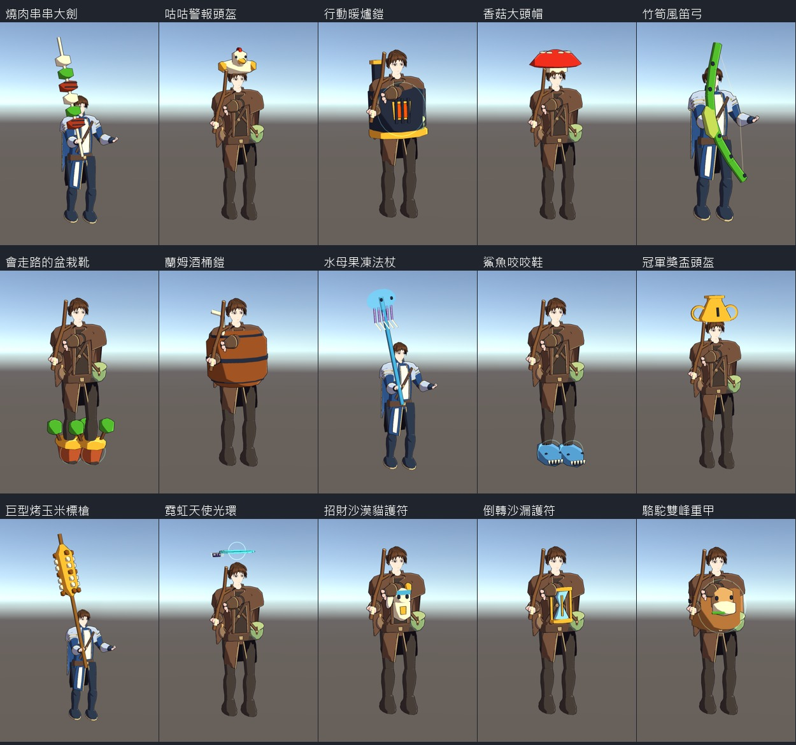
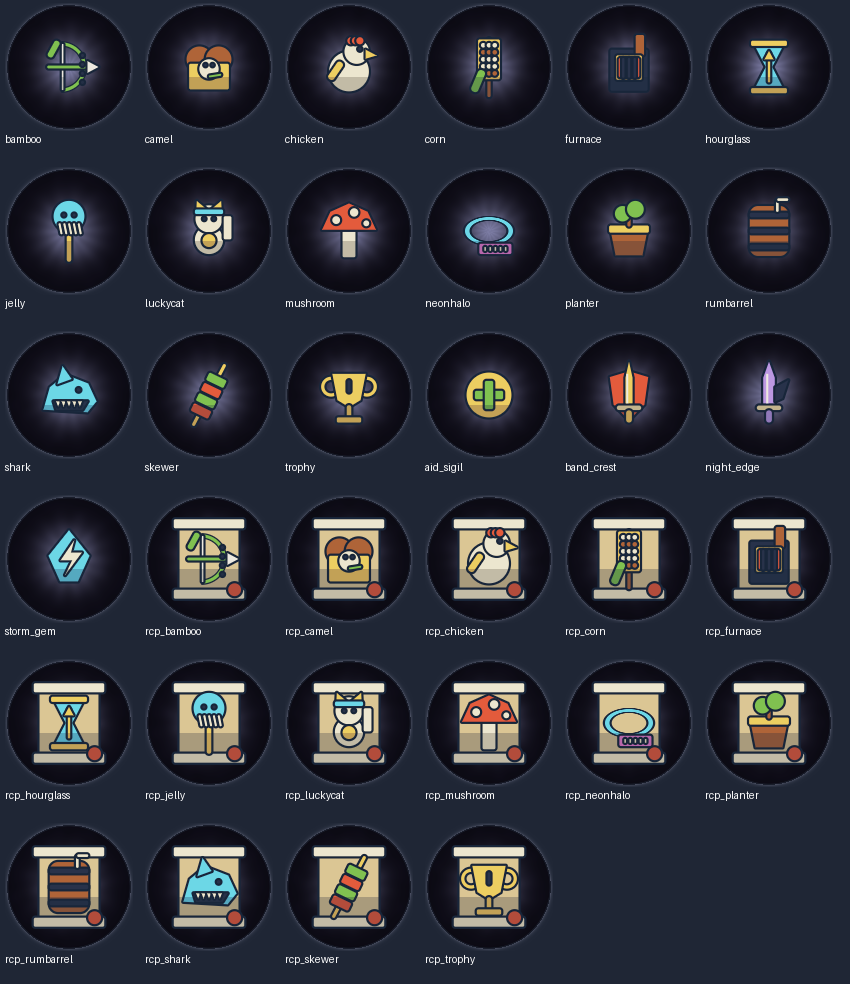

# 特殊配方裝備美術

15種專屬程序模型，依 `GearLook.Piece.special` 直接掛在既有關節。武器以劍士、獵人、法師三種持法驗證，其餘以初心者、牧師驗證；每件含雙鞋及光環線段估算不超過1500三角形。圖片沿用 GearPreview 的 CharacterRig.Create / SetGear 路徑，為 Unity 原生渲染。

- `blueprint_bp_*_<職業>.png`：完整穿戴預覽。
- `blueprint_icon_*.png`：15裝備、15卷軸、4材料，圖案純程式生成。
- `icons_overview.png`：全部圖示總覽。
- `native_validation.json`：各件實測三角形、卸裝還原及圖示快取。
- `build_validation.json`：原生與雙平台作業證據。

換特殊武器時保留手腕與舊武器關節，只隱藏舊渲染面；卸裝或停用租約會還原，沒有修改戰鬥或連線。雲與裝備材質共用；常駐小動畫不建立材質或網格。水母鐘罩透明抖動、招財貓招手、公雞鳥喙跟受擊動作、竹弓弦跟Charge；神話加常駐光環。音效與戰鬥觸發效果不在這次修改範圍。

## 預覽索引

| 裝備 | 穿戴預覽 |
|---|---|
| 燒肉串串大劍 | [swordsman](blueprint_bp_skewer_swordsman.png) / [archer](blueprint_bp_skewer_archer.png) / [mage](blueprint_bp_skewer_mage.png) |
| 咕咕警報頭盔 | [novice](blueprint_bp_chicken_novice.png) / [priest](blueprint_bp_chicken_priest.png) |
| 行動暖爐鎧 | [novice](blueprint_bp_furnace_novice.png) / [priest](blueprint_bp_furnace_priest.png) |
| 香菇大頭帽 | [novice](blueprint_bp_mushroom_novice.png) / [priest](blueprint_bp_mushroom_priest.png) |
| 竹筍風笛弓 | [swordsman](blueprint_bp_bamboo_swordsman.png) / [archer](blueprint_bp_bamboo_archer.png) / [mage](blueprint_bp_bamboo_mage.png) |
| 會走路的盆栽靴 | [novice](blueprint_bp_planter_novice.png) / [priest](blueprint_bp_planter_priest.png) |
| 蘭姆酒桶鎧 | [novice](blueprint_bp_rumbarrel_novice.png) / [priest](blueprint_bp_rumbarrel_priest.png) |
| 水母果凍法杖 | [swordsman](blueprint_bp_jelly_swordsman.png) / [archer](blueprint_bp_jelly_archer.png) / [mage](blueprint_bp_jelly_mage.png) |
| 鯊魚咬咬鞋 | [novice](blueprint_bp_shark_novice.png) / [priest](blueprint_bp_shark_priest.png) |
| 冠軍獎盃頭盔 | [novice](blueprint_bp_trophy_novice.png) / [priest](blueprint_bp_trophy_priest.png) |
| 巨型烤玉米標槍 | [swordsman](blueprint_bp_corn_swordsman.png) / [archer](blueprint_bp_corn_archer.png) / [mage](blueprint_bp_corn_mage.png) |
| 霓虹天使光環 | [novice](blueprint_bp_neonhalo_novice.png) / [priest](blueprint_bp_neonhalo_priest.png) |
| 招財沙漠貓護符 | [novice](blueprint_bp_luckycat_novice.png) / [priest](blueprint_bp_luckycat_priest.png) |
| 倒轉沙漏護符 | [novice](blueprint_bp_hourglass_novice.png) / [priest](blueprint_bp_hourglass_priest.png) |
| 駱駝雙峰重甲 | [novice](blueprint_bp_camel_novice.png) / [priest](blueprint_bp_camel_priest.png) |

特殊武器統一沿原武器局部Z長軸持握；竹弓另對齊既有弓弦平面，握把移到手掌原點。神話光環為常駐視覺，不提供屬性或傷害。

## 原生驗證

來源版本 `c2277044645038378888466889aeff84f75984f4`；[Unity 原生預覽作業](https://github.com/paul771127/AnimeGenerate/actions/runs/40702216395)通過。預覽由 `SpellDuel.EditorTools.Snapshot.RenderSkyGear` 產生，沒有用示意圖代替遊戲模型。

34組穿戴／卸裝全部還原原Renderer狀態，每件 **148～860三角形**（雙鞋合計、含光環線段估算）。34個新圖示皆唯一，快取重用通過；另以實際Render函式比對149個舊圖示像素不變。

全站Snapshot另在[出怪檢查](https://github.com/paul771127/AnimeGenerate/actions/runs/40697249304)回報 `DungeonSpawnAudit.Roster: Incorrect enemy count`。這是保留的既有戰鬥檢查，本批沒有修改Combat或跳過該檢查；全站Snapshot不宣稱通過。

[雙平台建置](https://github.com/paul771127/AnimeGenerate/actions/runs/40702216262)：Android APK、iOS Unity匯出及Xcode IPA編譯全部成功。`build_validation.json` 保存各作業與來源版本。TestFlight自動上傳是後續發布流程，不作為本批編譯驗證。
