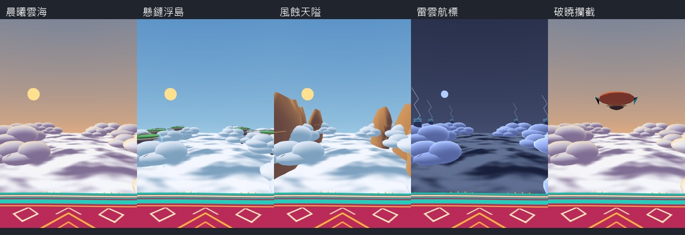

# 天穹航路環境重製

每站各一張第一人稱直式圖（`skyenv_<站號>_first.png`）及俯視圖（`skyenv_<站號>_top.png`），站號0～4依序為晨曦雲海、懸鏈浮島、風蝕天隘、雷雲航標、破曉攔截。全部是 Unity 程序幾何原生截圖。

三層雲以方向光、陰影及透光邊緣呈現體積，遠中近移動速率為0.055／0.38／1倍。漸層天幕在120m遠，雲／岩／航標在場地左右外側；低透明度雲霧沿外緣流動。浮島含岩層、草冠、瀑布、鏈橋，雲裙下降讓地標可見；風隘為沿航路連接的圓弧砂岩壁與風蝕層理；雷站閃光只改雲材質，不改AR真實畫面或全域燈光。

終站的遠景飛艇位在場地外44m，包含氣囊、吊艙、繩索、甲板與操舵帆，日輪在其後方。飛艇沒有碰撞或敵人邏輯。

飛毯新增4.5cm厚邊與飄動流蘇；布面校正及原有SurfacePoint不改，敵人+5cm與HighBar=1.1保持。原生檢查逐頂點比對SurfacePoint、逐站40k三角（含線段估算）及動畫期間網格／材質數不增加。每站邊霧最多50粒、落地塵24粒；材質、雲與天幕網格共用。

`native_validation.json` 與 `build_validation.json` 記錄實測；中階手機實際幀時間仍需裝置量測，沒有以編譯成功替代實機效能結論。

## 預覽索引

| 站景 | 第一人稱 | 俯視 |
|---|---|---|
| 晨曦雲海 | [查看](skyenv_0_first.png) | [查看](skyenv_0_top.png) |
| 懸鏈浮島 | [查看](skyenv_1_first.png) | [查看](skyenv_1_top.png) |
| 風蝕天隘 | [查看](skyenv_2_first.png) | [查看](skyenv_2_top.png) |
| 雷雲航標 | [查看](skyenv_3_first.png) | [查看](skyenv_3_top.png) |
| 破曉攔截 | [查看](skyenv_4_first.png) | [查看](skyenv_4_top.png) |

雲密度紋理由程式一次生成128×128 RGBA貼圖（64KB），五站共用、雙層可重複噪聲。雲材質每像素一次取樣；遠景雲海提高密度明暗、體積雲保持柔和紋理，沒有使用外部圖片。

鏈橋實際跨接同側下一座浮島，橋板以32個四邊面組成共用網格；瀑布從草坡外緣落下。俯視圖中央保留的空洞是AR真實場地區域，沒有以雲海覆蓋玩家腳下。

## 原生驗證

來源版本 `c2277044645038378888466889aeff84f75984f4`；[Unity 原生預覽作業](https://github.com/paul771127/AnimeGenerate/actions/runs/40702216395)通過。預覽由 `SpellDuel.EditorTools.Snapshot.RenderSkyGear` 產生，沒有用示意圖代替遊戲模型。

五站三角形依序為 **27,616 / 38,336 / 33,436 / 38,236 / 29,472**（含線段保守估算）；SurfacePoint逐頂點比對、動畫期間網格／材質數量穩定與HighBar=1.1皆通過。

全站Snapshot另在[出怪檢查](https://github.com/paul771127/AnimeGenerate/actions/runs/40697249304)回報 `DungeonSpawnAudit.Roster: Incorrect enemy count`。這是保留的既有戰鬥檢查，本批沒有修改Combat或跳過該檢查；全站Snapshot不宣稱通過。

[雙平台建置](https://github.com/paul771127/AnimeGenerate/actions/runs/40702216262)：Android APK、iOS Unity匯出及Xcode IPA編譯全部成功。`build_validation.json` 保存各作業與來源版本。TestFlight自動上傳是後續發布流程，不作為本批編譯驗證。
