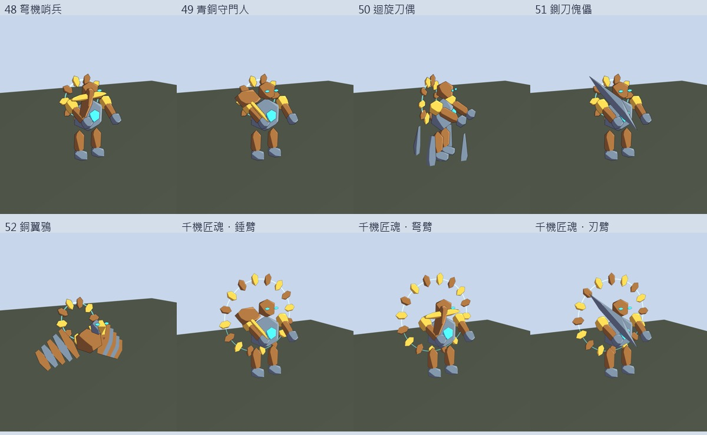
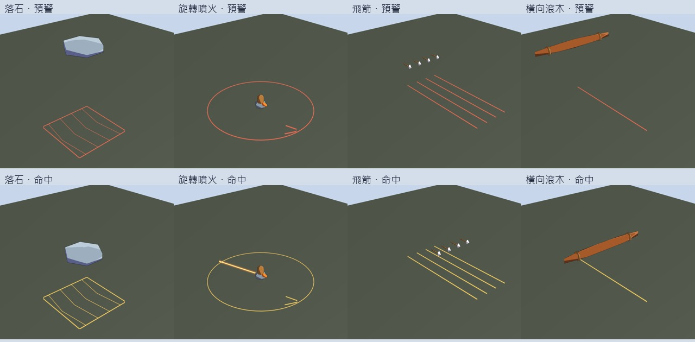

# 千機迴廊驗收預覽

本目錄的 PNG 由 Unity 2022.3 的 `Snapshot.Render` 原生渲染產生；不是參考圖或 AI 示意圖，也不會匯入遊戲 Resources。模型、材質顏色、警戒線和投射物均來自實際程序美術程式。

建置來源：`9394d2b`。Android APK 與 iOS 專案匯出均成功，詳見 [GitHub Actions](https://github.com/paul771127/AnimeGenerate/actions/runs/40246963414) 與本目錄的 JSON 證據。





## 圖片索引

| 檔名 | 內容 |
| --- | --- |
| `trap_Rock_warn.png` / `trap_Rock_impact.png` | 單一象限落石預警／落地 |
| `trap_Flame_warn.png` / `trap_Flame_impact.png` | 火柱半徑與旋轉方向／腳踝火焰 |
| `trap_Arrows_warn.png` / `trap_Arrows_impact.png` | 同側四支箭與保留走道／箭飛越場地 |
| `trap_Log_warn.png` / `trap_Log_impact.png` | 懸吊橫木／胸口高度掃過 |
| `vault_enemy_48_phase1.png` | 弩機哨兵 |
| `vault_enemy_49_phase1.png` | 青銅守門人 |
| `vault_enemy_50_phase1.png` | 迴旋刀偶 |
| `vault_enemy_51_phase1.png` | 鍘刀傀儡 |
| `vault_enemy_52_phase1.png` | 銅翼鴉 |
| `vault_enemy_53_phase1.png` / `vault_enemy_53_phase2.png` / `vault_enemy_53_phase3.png` | 千機匠魂錘／弩／刃臂 |
| `vault_mythic_card.png` | 由實際神話 Item 資料繪製的英文測試物品卡；手機背包仍使用既有中文 UiKit 物品卡 |

`trap_dungeon_audit.json` 是 Unity 執行的整合檢查結果，`audit.log` 保留相關檢查紀錄，`native_source.json` 記錄圖片來源提交及 Actions 連結。平台建置另記於 `platform_builds.json`。

## 自動檢查範圍

- 八個副本的劇本格式；原七個副本內容不變。
- 千機迴廊兩條路線都九場普通戰鬥加一場 Boss；兩路線各三種抉擇，模擬房主／隊友進度一致。
- 真正 Battle 出怪迴圈跑完 41～50 波，單人與四人規模各一次；沒有舊怪混入。
- 65 個接觸、跳／蹲／離開範圍、新怪與十波案例；同次攻擊只扣一次血、環境不傷 NPC、房間序號拒收舊預警、重送不重複、取消攻擊同步。
- 預警 3.5 秒以上、危險時段間隔兩秒以上、火柱離出生點至少 1.5 公尺；Boss 70%／35% 階段與 10% 停機。
- 25 分鐘時計、上發條一次、超時；小麥死亡不失敗；拉桿三結果。
- 神話裝主屬性、額外詞綴、四孔上限、新舊存檔；10,000 次最終掉落的 3% 神話／30% 專屬套裝，以及普通掉落不洩漏專屬裝。
- 新模型的頂點色路徑、三角形預算、MinionRig 包裝；陷阱線寬不會在脈動時失去原設定。

重跑內容及原生證據檢查：

```sh
python3 spellduel-unity/Tools/check_trap_dungeon.py --require-native
```

## 手機驗收仍需執行

自動檢查是純戰鬥模擬與 Unity 原生渲染，不能取代兩台實際手機的網路／AR／動作辨識和 FPS 測試：

1. 第四章 4-6 通關後，在副本入口找到千機迴廊；確認每人倒數相同。
2. 兩台手機分別以跳、蹲、側移與離開範圍避四種機關；確認 NPC／寵物未受環境傷害。
3. 分別走箭雨路與囚籠路；確認各九戰再到 Boss，小麥死亡不判敗、存活多一箱。
4. 疤面亞克三種抉擇、鈴音任務／預報、市集各人買藥與房主上發條一次。
5. 前廳三拉桿各試一次，再試等待 20 秒自動選；倒數不能停。
6. Boss 三階段、高低交替、10% 停機五秒，兩端預警及取消攻擊一致。
7. 等待超時並確認待領戰利品丟棄；另一次通關檢查金幣、保底橙裝、時間與最快紀錄。
8. iOS Metal 與 Android GLES3，在多人與大量機關同場時量 FPS／溫度，並測短暫背景切換與 AR 追蹤恢復。
